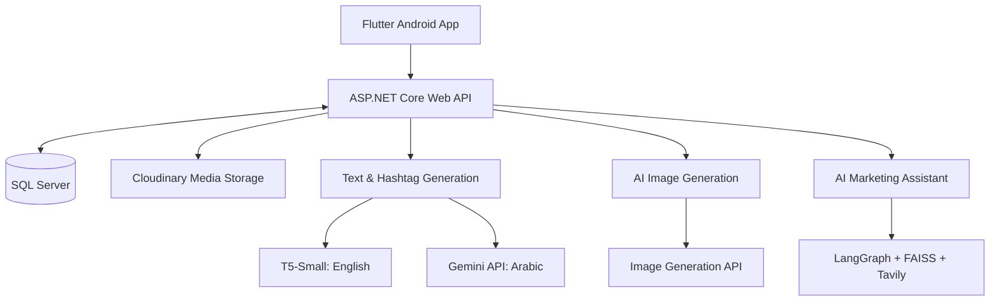

# AD GENERATOR AI

**AI-Powered Marketing Campaign Generator**  
**Graduation Project | 2026**

AD GENERATOR AI is an AI-powered mobile application designed to simplify digital marketing campaign creation for businesses and content creators.

The system generates personalized marketing campaigns featuring three distinct post variations, AI-generated promotional images, bilingual captions, platform-specific hashtags, and intelligent marketing assistance.

## Project Overview

Creating effective marketing campaigns across multiple digital platforms can be time-consuming and challenging, especially for small businesses with limited marketing resources.

AD GENERATOR AI addresses this challenge by integrating AI-powered content generation, promotional image creation, posting-time recommendations, and intelligent marketing assistance into a single mobile application. The system supports Arabic and English content generation, multiple products within one campaign, and tailored outputs for Instagram, Facebook, TikTok, and Websites/Ads.

## Project Demo

Watch AD GENERATOR AI in action and explore how the application transforms campaign inputs into AI-generated marketing content.

**[Watch the Project Demo](https://github.com/menna-ahmed-amer/AI-Marketing-Campaign-Generator-Graduation-Project/releases/tag/v1.0.0)** — open the demo folder to view the application walkthrough.

## Key Features

- **AI-Powered Campaign Generation:** Create personalized marketing campaigns based on product details, campaign goals, target audience, and creative preferences, with support for single and multiple products.
- **Three Post Variations:** Generate Product-Focused, Lifestyle-Focused, and Campaign-Focused posts, each featuring marketing captions, hashtags, and promotional images.
- **Bilingual Content Generation:** Generate AI-powered marketing captions and hashtags in both English and Arabic.
- **Platform-Specific Content:** Tailor marketing content and hashtags for Instagram, Facebook, TikTok, and Websites/Ads.
- **AI-Generated Promotional Images:** Create advertising visuals aligned with campaign themes, product information, and creative styles.
- **RAG-Powered Marketing Assistant:** Receive AI-powered guidance on marketing strategies, branding, sales, and audience engagement through an intelligent chatbot.
- **Smart Posting Recommendations:** Get recommended publishing times based on the selected platform to support campaign planning.
- **Campaign Library & Management:** Save, organize, and revisit previously generated campaigns through a dedicated campaign library.

## How It Works

1. **Configure a campaign:** Enter the campaign objective, audience, platform, language, product details, and creative preferences. Add one or more products as needed.
2. **Generate three approaches:** Receive Product-Focused, Lifestyle-Focused, and Campaign-Focused post variations.
3. **Review generated content:** Explore AI-generated captions, platform-specific hashtags, and promotional images for each variation.
4. **Plan publishing:** Review suggested posting times and platform guidance. Publishing to social platforms is a separate, manual step.
5. **Save and revisit campaigns:** Organize generated campaigns in the campaign library for later review and reuse.

## Tech Stack

| Layer / Component | Technologies |
| --- | --- |
| **Mobile application** | Flutter, Dart (Android) |
| **Backend & APIs** | C#, ASP.NET Core 8 Web API, Entity Framework Core, REST APIs |
| **Database** | Microsoft SQL Server |
| **Text & hashtag generation** | Python, Hugging Face Transformers, fine-tuned T5-Small (English), Gemini API (Arabic integration) |
| **AI image generation** | Stable Diffusion + LoRA (experiments), Gemini image generation via OpenRouter (integrated API) |
| **Marketing chatbot** | LangGraph, Retrieval-Augmented Generation (RAG), FAISS, Tavily |
| **Authentication & media** | ASP.NET Core Identity, JWT, Google Sign-In, Cloudinary |
| **Development & design** | Google Colab, Swagger, Figma |

## System Architecture

The application separates the mobile interface, backend services, database, and AI components to support modular development and integration.



*High-level architecture based on the graduation project documentation. Module-specific folders and their READMEs will contain implementation-specific details.*

## AI Models & Techniques

### Text & Hashtag Generation

The bilingual content-generation module produces marketing captions and hashtags adapted to campaign inputs, chosen platforms, and post variation types.

**English — Fine-Tuned T5-Small**

- Fine-tuned `google-t5/t5-small` for structured marketing copy generation.
- Worked with a **50,000-record** fashion-marketing dataset, expanded into **150,000 text-generation training pairs** across three post variations.
- Used task-specific prefixes and structured product attributes to guide generation of Product-Focused, Lifestyle-Focused, and Campaign-Focused content.
- Applied output post-processing to separate captions from hashtags and adapt results to the chosen platform.

**Arabic — LLM-Based Generation**

- Generated Arabic marketing content using language-aware prompting and formatting rules.
- The integrated-system documentation identifies **Gemini API** for Arabic generation; it also documents a **Qwen2.5 local pipeline** explored during development. The published module code is the reference for its final implementation.

*The Arabic and English text-and-hashtag work was developed collaboratively by two team members.*

### AI Advertising Image Generation

- Experimented with **Stable Diffusion and LoRA fine-tuning** for fashion-focused advertising images.
- Integrated an **API-based image generation pipeline** for promotional creative variations.
- Used campaign attributes and creative direction to generate visuals tailored to the selected platform.

### RAG-Powered Marketing Assistant

- Built a marketing assistant using **Retrieval-Augmented Generation (RAG)**.
- Used **LangGraph** to coordinate retrieval, relevance assessment, and response generation.
- Combined a **FAISS** marketing knowledge base with **Tavily** web search fallback when retrieved context is insufficient.

## Project Structure

The repository is organized by module. Team members will upload their source files and any module-specific README documentation into the relevant folders.

```text
AD-Generator-AI/
├── README.md
├── Demo/
│   └── [Application demo video]
├── Screenshots/
│   └── [Application screenshots]
├── docs/
│   └── AD_Generator_AI_Documentation.pdf
├── ai/
│   ├── text_hashtag_generation/
│   ├── image_generation/
│   └── marketing_chatbot/
├── backend/
└── mobile_app/
```

*This is the planned repository layout; folder contents will reflect the actual files contributed by the team.*

## Screenshots

Explore the **[Application Screenshots](Screenshots/)** to preview the user interface, campaign-creation workflow, and generated marketing content.

## Documentation & Presentation

- **[Graduation Project Documentation (PDF)](docs/AD_Generator_AI_Documentation.pdf)** — requirements, system design, implementation, evaluation, and future work.
- **[Project Presentation (Canva)](https://canva.link/8hf9jvo3gpz266i)** — presentation prepared by the project team.

## Team & Contributions

**Faculty of Computers and Artificial Intelligence — Artificial Intelligence Department**  
**Beni-Suef National University | July 2026**

| Team Member | Contribution | GitHub Profile |
| --- | --- | --- |
| Youssef Abdelnasser Ahmed | Image Generation (AI)  |[GitHub](https://github.com/YoussefAbdelnasser11?tab=repositories)|
| Mennatullah Ahmed Amer Ali | Generate Text & Hashtage (AR & Eng) | [GitHub](https://github.com/menna-ahmed-amer) |
| Manal Ramadan Ibrahim | Generate Text & Hashtage (AR & Eng) | — |
| Farah Mohsen Mohamed | Backend.Net | [GitHub](https://github.com/FarahMohsenmohammed) |
| Rawda Mohamed Ahmed | Backend.Net | — |
| Mennatullah Ibrahim Abdelhamed | Flutter (Mobile Application) | — |

*Contributions and GitHub profile links will be filled in from the team's confirmed roles and usernames. Arabic and English text-and-hashtag generation was a shared contribution by two members.*

**Project Supervisor:** Dr. Amal Fouad  
**Teaching Assistant:** Eng. Ehab Ibrahim

## Limitations & Future Work

**Current limitations**

- The mobile application currently targets **Android**.
- Posting-time recommendations do not automatically publish posts to social media.
- Real-world campaign engagement analytics are not yet integrated.
- Some image-generation functionality depends on external API availability.
- The in-app marketing chatbot currently accepts text questions rather than user-uploaded documents.

**Potential enhancements**

- Social media publishing and scheduling integration.
- Campaign engagement analytics and A/B testing.
- iOS support and expanded accessibility.
- More advanced Arabic-language generation and chatbot capabilities.

---

*AD GENERATOR AI — 2026 Graduation Project | Built collaboratively by a six-member team.*
